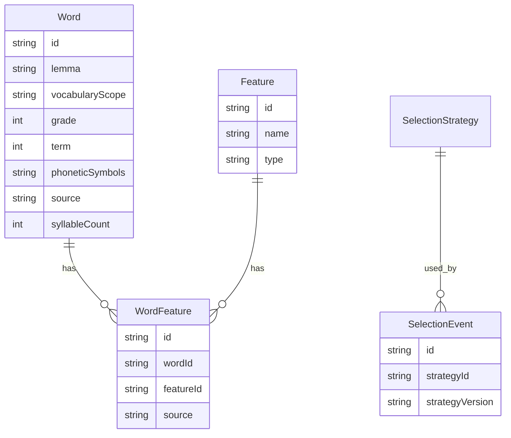

# Data Model (formal)

Formal persistence and runtime types for the Vocabulary Selection API demo.

Related: [description.md](description.md), [domain-models.md](domain-models.md), [algorithm.md](algorithm.md), [architecture.md](architecture.md).

This document is the implementable contract. Conceptual background lives in `domain-models.md`.

## Storage for this demo

Collections are JSON files under `api/data/`. The shape is relational (one collection per entity) so a database can replace files later.

| File | Role |
| --- | --- |
| `words.json` | Closed lexical pool |
| `features.json` | Feature definitions (`tag` and `score`) |
| `word-features.json` | Word ↔ Feature associations with scope and provenance |
| `word-ch-translations.json` | Chinese glosses keyed by lemma |
| `selection-strategies.json` | Known ranking strategies |
| `selection-events.json` | Append-only history of committed selections |

`Assessment` and `SelectionSession` are **runtime only**. They are not JSON collections in this demo.

---

## Entity relationship

```text
Word 1 --- * WordFeature * --- 1 Feature
Word  --- WordChTranslations (by lemma)

SelectionContext (value object on request, session, and event)
VocabularyLevel (value object on SelectionContext.levelRange)
VocabularyScope (string textbook / domain id)
SelectionStrategy 1 --- * SelectionEvent
```



---

## Value objects

### VocabularyScope

A string textbook / domain id. Demo seed uses `人教版`. Request alias `PEP` is stored as `人教版`.

Used on `Word.vocabularyScope`, `WordFeature.vocabularyScope`, and `SelectionContext.vocabularyScope`.

### VocabularyLevel

| Field | Type | Required | Notes |
| --- | --- | --- | --- |
| `grade` | integer | yes | 1–6 |
| `term` | `1` \| `2` \| null | yes | `1` first term, `2` second term, `null` full school year |

```json
{ "grade": 3, "term": 1 }
```

### LevelRange

| Field | Type | Required |
| --- | --- | --- |
| `from` | VocabularyLevel | yes |
| `to` | VocabularyLevel | yes |

`from` must be at or before `to`. Null `term` on an endpoint covers that whole grade.

### SelectionContext

| Field | Type | Required | Notes |
| --- | --- | --- | --- |
| `vocabularyScope` | string | yes | Textbook / domain id. |
| `levelRange` | LevelRange | no | Hard-filter on Word.grade / Word.term. |
| `activity` | string | yes | Demo: `dictation` only. |
| `count` | integer | yes | Visible list length. Range 1–50. Overridden if fewer words are eligible. |
| `preferredFeatureIds` | string[] | no | Tag preferences for `contextFit`. Never eliminates a candidate. |
| `difficultyPreference` | `easy` \| `medium` \| `mixed` \| `hard` | no | Default `mixed` (no difficulty weight). `midium` is accepted as `medium`. |
| `frequencyPreference` | `high` \| `mixed` \| `low` | no | Default `high`. `mixed` adds no frequency weight. |

```json
{
  "vocabularyScope": "人教版",
  "levelRange": {
    "from": { "grade": 3, "term": 1 },
    "to": { "grade": 3, "term": 2 }
  },
  "activity": "dictation",
  "count": 10,
  "preferredFeatureIds": ["feat-changkao", "feat-topic-environment"],
  "difficultyPreference": "mixed",
  "frequencyPreference": "high"
}
```

---

## Persisted entities

### Word

Stable properties of a lexical item. Context-dependent judgments (`contextFit`, `suitable`) do **not** live here.

`vocabularyScope`, `grade`, and `term` **are** the word’s scope. Eligibility compares these to the request, not `WordFeature`. Lemma length is computed at runtime if needed (`lemma.length`); it is not stored.

| Field | Type | Required |
| --- | --- | --- |
| `id` | string | yes |
| `lemma` | string | yes |
| `vocabularyScope` | string | yes |
| `grade` | integer | yes (1–6) |
| `term` | `1` \| `2` \| null | yes |
| `phoneticSymbols` | string | yes |
| `source` | string | yes |
| `syllableCount` | integer | yes |
| `createdAt` | ISO-8601 string | yes |

Invariant: `lemma` is unique (case-insensitive).

### Feature

Reusable feature definition. Associating a feature with a word is `WordFeature`.

| Field | Type | Required |
| --- | --- | --- |
| `id` | string | yes |
| `name` | string | yes |
| `type` | string | yes |

`type` is `tag` or `score`. Score features store a measurement in `WordFeature.value`; they do not contain ranking logic.

Demo seed features:

| id | name |
| --- | --- |
| `feat-changkao` | 常考词 |
| `feat-shengpi` | 生僻词 |
| `feat-writing` | 写作词汇 |
| `feat-topic-animals` | animals |
| `feat-topic-school` | school |
| `feat-topic-environment` | environment |
| `feat-topic-family` | family |
| `feat-topic-food` | food |
| `feat-frequency` | frequency (`score`) |
| `feat-difficulty` | difficulty (`score`) |

Topic tags are selected via `preferredFeatureIds` (e.g. `feat-topic-environment`), not a separate `topic` field.

### WordFeature

| Field | Type | Required | Notes |
| --- | --- | --- | --- |
| `id` | string | yes | |
| `wordId` | string | yes | |
| `featureId` | string | yes | |
| `value` | string \| number \| null | no | Null for tags; numeric measurement for `score` features. |
| `vocabularyScope` | string | yes | Provenance (textbook id). Not used for eligibility. |
| `grade` | integer \| null | no | Level the measurement applies to, when known. |
| `term` | `1` \| `2` \| null | no | Term the measurement applies to, when known. |
| `source` | string | yes | Demo seed: `LLM`. |
| `sourceVersion` | string | yes | Demo seed: `seed-v1`. |
| `createdAt` | ISO-8601 string | yes | |

Invariant: unique `(wordId, featureId, vocabularyScope, grade, term)`.

### WordChTranslations

Chinese gloss for dictation, keyed by lemma. One row per lemma in v1; `chTranslations` is a single string.

| Field | Type | Required |
| --- | --- | --- |
| `id` | string | yes |
| `wordLemma` | string | yes |
| `chTranslations` | string | yes |

### SelectionStrategy

| Field | Type | Required |
| --- | --- | --- |
| `id` | string | yes |
| `name` | string | yes |
| `version` | string | yes |
| `description` | string | yes |

Demo row:

```json
{
  "id": "RULE_VDEMO",
  "name": "Rule-based demo ranker",
  "version": "1",
  "description": "Hard filter by Word.vocabularyScope and grade/term; contextFit from tag match plus optional difficulty and frequency preferences."
}
```

### SelectionEvent

One committed teacher session. Snapshots lists so later analysis does not depend on live pool changes.

| Field | Type | Required |
| --- | --- | --- |
| `id` | string | yes |
| `selectionContext` | SelectionContext | yes |
| `strategyId` | string | yes |
| `strategyVersion` | string | yes |
| `initialCandidates` | CandidateSnapshot[] | yes |
| `finalSelection` | CandidateSnapshot[] | yes |
| `teacherActions` | TeacherAction[] | yes |
| `createdAt` | ISO-8601 string | yes |

`CandidateSnapshot`:

| Field | Type |
| --- | --- |
| `wordId` | string |
| `lemma` | string |
| `score` | number |
| `reasons` | string[] |

`TeacherAction`:

| Field | Type | Notes |
| --- | --- | --- |
| `type` | `keep` \| `remove` \| `replace` | |
| `wordId` | string | Word the teacher acted on. |
| `replacementWordId` | string \| null | Auto-picked on remove; teacher-supplied on replace. |
| `at` | ISO-8601 string | |

---

## Runtime types (not JSON collections)

### Assessment

Calculated per word under the current context. See [algorithm.md](algorithm.md).

| Field | Type |
| --- | --- |
| `wordId` | string |
| `contextFit` | number (0–1) |
| `score` | number (0–1, equals `contextFit` in v1) |
| `reasons` | string[] |

### SelectionSession

Working copy between generate and commit. Held in process memory.

| Field | Type |
| --- | --- |
| `id` | string |
| `selectionContext` | SelectionContext |
| `strategyId` | string |
| `strategyVersion` | string |
| `visible` | RankedCandidate[] |
| `recommendedWords` | RankedCandidate[] | Leftover top-ranked pool after the initial sample |
| `otherWords` | RankedCandidate[] | Remaining eligible words |
| `usedWords` | string[] | Ids that appeared on visible (including removed/replaced) |
| `teacherActions` | TeacherAction[] |
| `committed` | boolean |
| `createdAt` | ISO-8601 string |

`RankedCandidate` = `CandidateSnapshot` plus the full `Assessment` used to rank it.

Removed/replaced words stay in `usedWords` and are not auto-offered again. Manual replace may only pick leftover pool items that are not currently visible.

---

## Provenance

Externally sourced facts live on `WordFeature` (`source`, `sourceVersion`), not on `Feature`.

Demo seed: `source = LLM`, `sourceVersion = seed-v1`. Replacing seed later means rewriting `word-features.json` (and possibly `words.json`) without renaming Feature ids.

---

## Invariants (demo)

- `count` is an integer 1–50.
- `activity` must be `dictation`.
- `Word.grade` is an integer 1–6; `Word.term` is `1`, `2`, or `null`.
- When `levelRange` is present, `from` is at or before `to`.
- `topic` and `requiredFeatureIds` are rejected (400).
- A committed session cannot accept more actions.
- If leftover pools have no unused words, remove fails (409); the API does not invent words.
- `SelectionEvent` is append-only.
